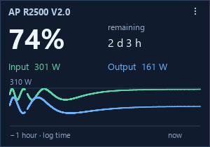
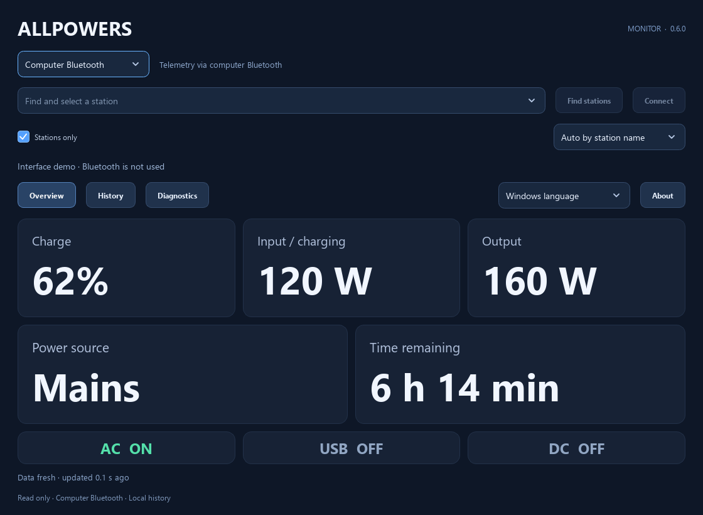
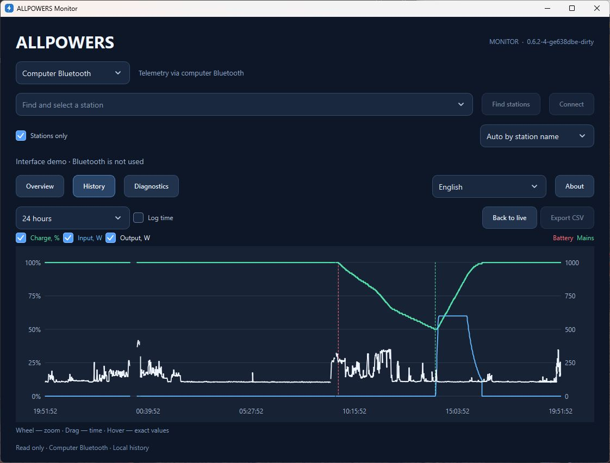

# ALLPOWERS

ALLPOWERS BLE telemetry: one portable C++23 core, two USB UPS boards and a
native Windows monitor. [Русская версия](README.ru.md) · [简体中文](README.zh-CN.md) · [繁體中文](README.zh-TW.md).

## The problem this solves

A power station can supply backup power to a computer, but its power cable does
not tell the computer the battery charge, a switch to battery power, or the
remaining runtime. Those readings help estimate the reserve and configure a
shutdown before the station runs out. ALLPOWERS brings its BLE telemetry to the
computer.

There are two main ways to use it:

- **USB UPS through a board.** Waveshare or Pocket connects to the station over
  BLE and reports battery state through standard USB HID UPS. This path works
  without leaving the monitor open; the OS handles battery policy and actions
  according to its power settings. The Windows apps can also read detailed
  telemetry and history from that board over USB.
- **Windows Monitor or Widget.** The app reads the station directly over
  Bluetooth or through a USB board, displaying charge, power, remaining runtime
  and graphs. Standalone viewing works without installing a service or driver.
  The board-free Windows UPS path using a service and driver remains experimental.

The project provides station-state data. Backup-power capability and transfer
time depend on the station itself. The confirmed HID UPS implementation covers
R2500 V2; see the model support limits below.

| Product | Connection | Features |
| --- | --- | --- |
| Waveshare ESP32-S3-LCD-1.47 | BLE Central → USB Device | HID UPS, display, history, diagnostics, RGB |
| Pocket-Dongle-S3 0.96 N16R8 | BLE Central → USB Device | HID UPS, compact display, history, diagnostics |
| Windows Monitor | Computer Bluetooth / Qt WinRT or USB CDC board | Telemetry, graphs, diagnostics; optional experimental Windows UPS integration |
| Windows Widget | Computer Bluetooth or USB CDC board | Standalone desktop card with telemetry and an hourly power graph |

The core recognizes 17 model names and three protocol families. USB UPS reporting
is implemented for R2500 V2; other profiles expose only their known fields.
Some stations accept one BLE client: disconnect a board before connecting the PC.
Alternatively select **USB · Waveshare / Pocket** to read the board's connection.
The app remembers the transport, USB serial and Bluetooth station separately.
USB disconnect closes only the PC port. Live readings share charts, local history
and CSV; board diagnostics appear in the table. No flashing or extra driver is
required. The board archive automatically fills gaps in the main USB history
chart; its records remain labelled separately because they lack station identity.
See [USB mode](docs/usb-monitor.md).
Archive diagnostics distinguish a verified complete import from partial/error
results. Legacy readers receive a compatible AHP1 projection; exact unknown-field
semantics require the current versioned export. Firmware rollback requires an
AHP1/AHP2-compatible package with matching metadata; see [recovery](docs/recovery.md).
Long archive reads continue to send live USB status. After an import error, a
retry safely replaces any export still active on the board.
Updated desktop and firmware also use a fresh per-read operation token across
application restarts; [USB compatibility limits](docs/usb-monitor.md#operation-identity-across-client-restarts)
describe the weaker correlation available with older firmware.

## Start here

Run **AllpowersMonitor.exe** for the full interface or **AllpowersWidget.exe**
for the desktop card. Choose USB to use a board already connected to the station;
choose Bluetooth for a direct PC connection. Disconnect the other direct client
first. If Bluetooth is busy, release the connection in the other app or board;
the application does not take it over. An installed UPS service owns Bluetooth
and supplies viewers with its readings.

Stale means the required telemetry has expired. Missing or stale values are not
evidence of an empty battery. Settings/history are local to each app under
`%LOCALAPPDATA%`; the paths and archive limitations are described below.

| Protocol family | Known telemetry | Hardware evidence |
| --- | --- | --- |
| R2500 V2 | Charge, input/output, runtime, AC/DC/USB outputs, explicit mains/battery source | R2500 V2 + Waveshare BLE/GATT and HID UPS on Windows, 2026-10-25; see [validation](docs/validation.md) for the tested revision |
| Legacy16 | Charge, power, runtime, AC/DC/light outputs; USB output and mains source unknown | Offline protocol tests; individual catalog models and Pocket hardware unverified |
| Old10 | Charge, power, runtime, cycles, AC/DC/USB/light outputs; mains source unknown | Offline protocol tests; individual catalog models unverified |

Pocket is compiled and protocol-tested. The native Windows UPS driver/service
remains experimental for every model; successful HID reporting on a board does
not validate the driver. Catalog recognition alone does not establish compatibility.

**Interface examples**

<table>
  <tr>
    <th width="33%">Windows Widget</th>
    <th width="34%">Waveshare · 1.47″</th>
    <th width="33%">Pocket · 0.96″</th>
  </tr>
  <tr>
    <td align="center" valign="middle"><a href="docs/images/windows-widget-en.png"></a></td>
    <td align="center" valign="middle"><a href="docs/images/waveshare-display.png"></a></td>
    <td align="center" valign="middle"><a href="docs/images/pocket-display.png"></a></td>
  </tr>
</table>

<table>
  <tr>
    <th width="50%">Monitor · Overview</th>
    <th width="50%">Monitor · History</th>
  </tr>
  <tr>
    <td align="center"><a href="docs/images/windows-monitor-en.png"></a></td>
    <td align="center"><a href="docs/images/windows-history-en.png"></a></td>
  </tr>
</table>

Both Windows applications support Russian, English, Simplified Chinese and Traditional
Chinese. Select **Windows language**, **Русский**, **English**, **简体中文**, or
**繁體中文** beside **About** in the monitor or in the widget's **Settings**.
Each application saves its own choice and applies it after you close and reopen it.
By default Russian Windows uses Russian; Chinese Windows uses the appropriate
Simplified (China/Singapore) or Traditional (Taiwan/Hong Kong/Macao) variant;
other languages use English. Translations are embedded in each EXE.
For an isolated preview use `--demo --language zh-CN` or `--demo --language zh-TW`;
`ru` and `en` remain available. The command-line choice is not saved.

The Windows package includes **AllpowersMonitor.exe** and **AllpowersWidget.exe**.
Each application runs from its own EXE: Qt, SQLite, platform plugins, the protocol core
and the C++ runtime are statically linked. No Qt/Python installation is needed.
Graphs support wheel zoom, panning, crosshair values, series visibility,
linear/logarithmic time, source-change markers and CSV export. Disk work runs
outside the UI thread. History/settings stay in `%LOCALAPPDATA%/AllpowersMonitor`.
The widget runs without the monitor and keeps separate settings/history in
`%LOCALAPPDATA%/AllpowersWidget`. On first launch, select Bluetooth or USB,
discover a device and save. The rectangular 300 × 210 card uses the device name
as its heading and displays charge, input/output, remaining time in
days/hours/minutes and two power traces for the last hour, with gaps for missing
data. Drag anywhere on the card except its menu button to move it; right-click or use the tray icon for settings,
connect/disconnect, position locking and exit. Optional login startup is off by default.
Normal windows cover the card; Win+D leaves it on the desktop. If Explorer
attachment is unavailable, no floating window appears: the tray reports the
reason and attachment is retried automatically.
The monitor and widget take turns owning a direct connection: disconnect in one
before connecting in the other. Ownership protection requires the new versions
of both applications; disconnect an already running older monitor manually.
With the UPS service installed, the widget reads the service's Bluetooth data
and never stops it on exit. The widget owns its USB port directly.
On USB connection/reconnection it automatically reads the board archive and merges
it with current samples into one line per metric, preserving genuine data gaps.
Its logarithmic time axis gives recent seconds more space within the one-hour
history. Lines join consecutive valid samples; isolated samples have no endpoint dot.
Run `AllpowersWidget.exe --demo` to preview without hardware; demo uses temporary
storage and does not change user settings or login startup.
Diagnostics includes a live event log that follows new entries. Scrolling up
pauses following; “Latest entries ↓” resumes it. The view retains 2000 lines;
the disk log rotates independently.
Current diagnostic state is a grouped parameter/value table; full JSON can still
be copied for troubleshooting.
Experimental driver management is inside Diagnostics → **Windows UPS…**.
On normal startup, the monitor automatically searches for and connects to the
last saved station, using its Bluetooth address and saved protocol profile.
If it is unavailable, discovery is retried; Disconnect cancels waiting/retries.
Demo and automated tests do not use real Bluetooth connections.
F11 toggles fullscreen and restores the previous normal/maximized window mode.
Overview cards and text scale to the available window space, including fullscreen.

An optional LocalSystem service owns BLE and shared history and feeds a KMDF
Battery Class miniclass. Multiple monitors then share its connection. The EXE
embeds the driver package, but the default payload is unsigned and installation
is restricted to a test VM with a trusted signed payload. **Native driver/service
BLE and Windows power actions are not yet validated; VM tests are deferred.**
Standalone monitoring remains available without integration. See
[Windows UPS implementation and test status](docs/windows-ups.md).

## Build

Use Git, CMake 4.4+ and Ninja (pinned CMake 4.4.4 / Ninja 1.13.2). Windows also
needs MSVC 2026 C++ Build Tools and Windows 11 SDK 10.0.26100.0. Run Windows commands in an
**x64 Developer PowerShell**; Linux needs a C++23 compiler. Python and uv are not
used by the project build, tests or packaging.

```sh
# Windows: core, native tests, monitor and widget
cmake --preset windows
cmake --build --preset windows
ctest --preset windows
cmake --build --preset release

# Linux: portable core/tests (no Linux desktop app yet)
cmake --preset native
cmake --build --preset native
ctest --preset native
```

The first Windows build downloads checksum-pinned Qt 6.12.0 source and builds the
static MSVC/WinRT SDK with ExternalProject. Later builds reuse it. Existing static
Qt (including matching LinguistTools) can be selected with `-DALLPOWERS_QT_ROOT=/path/to/qt`.
Release builds optimize both applications and the managed Qt SDK for size with
ordinary linking, without LTO. Each EXE remains self-contained; no functionality or
languages are removed. Debug keeps its normal compiler settings. The standalone
`apps/windows` project accepts `-DALLPOWERS_OPTIMIZE_SIZE=OFF` for application-only
comparisons with the same Qt SDK; this does not change how that SDK was built.
GitHub Actions also caches the installed static SDK with an exact compatibility
key covering Qt/build inputs, MSVC, Windows SDK, architecture, tools and install
path. Restored SDKs must pass a compile/link and offline runtime check; a missing
or rejected cache falls back to building Qt from source.
The Windows target also builds/embeds the driver using checksum-pinned WDK
10.0.26100.6584 (KMDF 1.31), with INF/catalog/kernel-PE checks. `ups-driver` builds
only that package. Building or testing does not install it.

Firmware targets are available in either preset:

```sh
cmake --build build/windows --target arduino-setup
cmake --build build/windows --target waveshare-147 pocket-096
```

Use `build/native` on Linux. Setup pins Arduino CLI 1.5.1 and ESP32 Core 3.3.11.
Use `cmake --build --preset all-windows` or `all-linux` for all supported products.
Each board has independent sketch/build staging; no source is modified. Build,
CTest and packaging never flash devices or connect a station.

Outputs: `build/` for intermediate files, `dist/firmware/<board>/` for images,
`dist/windows/AllpowersMonitor/` for `AllpowersMonitor.exe` and `AllpowersWidget.exe`.
The `release` target uses CPack to create runtime and corresponding-source ZIPs
with SHA256 files. Runtime ZIPs contain UPX `-9` compressed copies of both EXEs;
the ordinary build/install outputs stay uncompressed for fast development.
UPX 5.2.1 is downloaded with a pinned SHA256 only during release packaging.
Packed EXEs pass integrity, version and isolated offline checks before archiving.
Some antivirus products may flag packed executables; `upx -d` unpacks them.
The source ZIP includes complete Qt archives and relinking
instructions; keep it with binary distributions.
Each firmware package also contains its LGPL corresponding sources, license
notices and a tested object kit for relinking. See [firmware licenses](docs/firmware-licenses.md).
Windows publishers need a valid Visual Studio license; qualifying personal and
open-source development can use Community. See [runtime terms](docs/windows-runtime-terms.md).

## GitHub builds and publication checks

GitHub Actions runs on pushes to `main`, tags, pull requests and manual requests.
Feature branches use PR checks instead of a duplicate push build; before opening
a PR, a build can be started manually. CI installs checksum-verified Ninja 1.13.2
on both platforms. A publication gate checks the index, working tree and reachable
history, including a pinned
Gitleaks secret scan. Windows Server 2025 builds the static monitor/widget and
driver; Ubuntu 24.04 builds the portable core. Both jobs compile both board
profiles and run CTest. Windows also rebuilds/tests the source kit and creates
CPack ZIPs with checksums. Successful jobs retain build artifacts for 14 days.
CTest presets run the full suite with four parallel jobs; use `--parallel 1`
for a sequential run. Tagged builds use the same packaging checks as other builds.
Pushing a version tag such as `v1.2.3` or `v1.2.3-alpha.1` additionally publishes
a [GitHub Release](https://github.com/borro/allpowers-bridge/releases) after both
platforms pass. It includes standalone Monitor/Widget EXEs, the Windows ZIP, both
board firmware ZIPs, complete application/Qt sources and SHA256 checksums.
The application and Windows EXE properties use the tag version without `v`.
Prerelease tags produce GitHub prereleases. Ordinary branch/PR builds produce
artifacts. Builds never install or flash anything; no personal tokens are required.
See [release safeguards and reruns](docs/building.md#tagged-releases).

Before committing, run `audit-worktree`; after reviewing/staging files, run
`audit`, `audit-history` and `audit-secrets` in the configured build directory.
Source packages use a reviewed file inventory, never a directory-wide copy.
Private configuration, recovery images and local build caches stay outside Git.
See [building and publication](docs/building.md) for the commands.

## Versions and layout

Product versions come from Git tags such as `v0.4.0`, using `git describe`.
Tagged CI selects the triggering tag exactly and verifies its commit.
Intermediate builds include commit/dirty information. The source kit carries a
generated `VERSION` file so an extracted archive retains its version without Git.
There is no hand-maintained product version in CMake or a package manifest.

`core/` owns protocol/model state and C ABI v1; `firmware/` shares logic between
board profiles; `apps/windows/` is the native Qt monitor; `tests/` contains C++
tests and sanitized fixtures; `cmake/` owns build/dependency/package rules.
`drivers/windows/` owns the optional battery miniclass. `tools/` contains explicit
board maintenance only (updating, identity and image-integrity checks). Real identities,
ports and rollback paths are ignored local settings, never public defaults.

Boards remember the selected station in NVS. Without one, the device picker opens.
BOOT changes pages; double BOOT opens the picker. RESET remains a hardware reset.
Read [recovery](docs/recovery.md) before writing any firmware. C ABI, USB descriptors,
flash partitions and the existing maintenance command remain compatible.

[Build details](docs/building.md) · [Architecture](docs/architecture.md) ·
[Boards](docs/boards.md) · [Validation](docs/validation.md) · [Relinking](docs/relinking.md).

Original project code is MIT; the adapted Windows driver is MS-PL.
[Third-party notices](THIRD_PARTY_NOTICES.md) retain their
licenses. Factory images, raw captures and user data are kept outside Git.

Translation maintenance: `cmake --build build/windows/windows-monitor --target update-translations`
updates the Russian and both Chinese Qt Linguist catalogs explicitly. Normal builds compile and embed it
without editing sources; `translation-coverage` checks missing translations.
