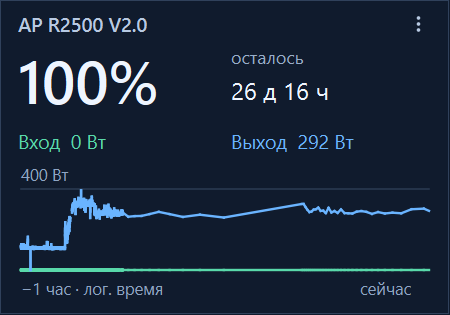
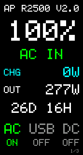
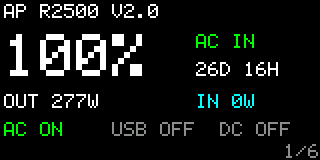
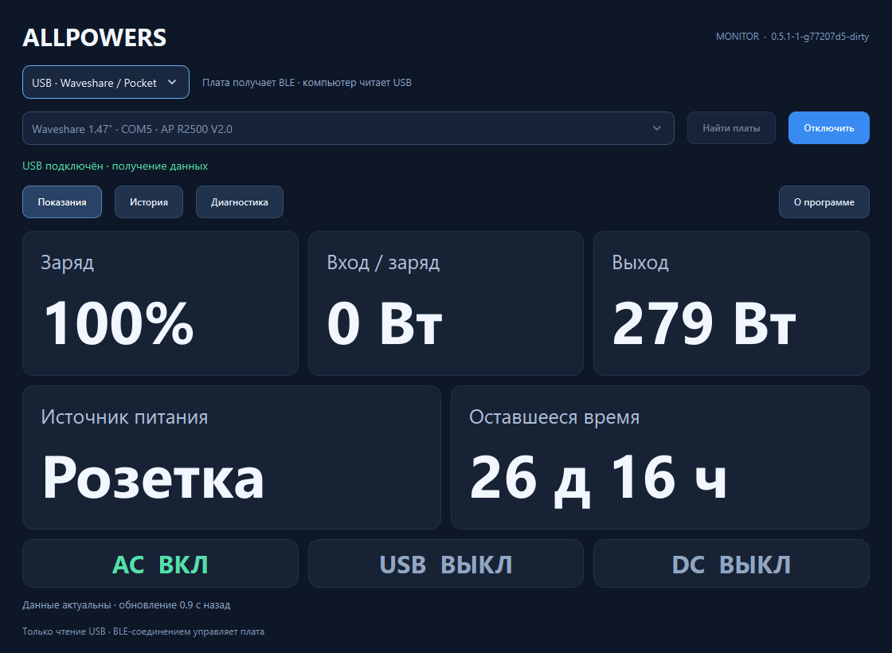
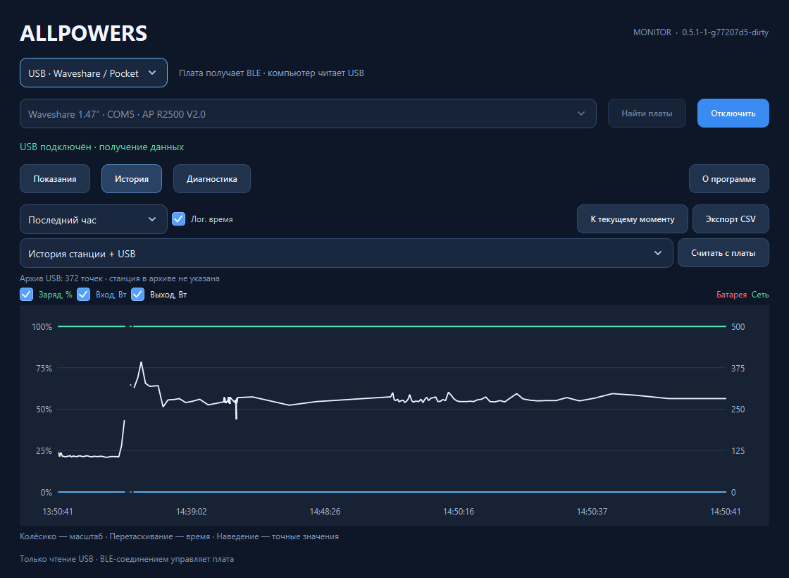

# ALLPOWERS

Телеметрия ALLPOWERS по BLE: общее C++23-ядро, две платы USB-ИБП и нативный
монитор Windows. [English](README.md).

## Какую проблему решает проект

Зарядная станция может обеспечивать компьютер резервным питанием, но силовой
кабель не передаёт компьютеру её заряд, переход на батарею и оставшееся время.
Без этих данных трудно оценить запас энергии и настроить завершение работы
до отключения станции. ALLPOWERS передаёт её BLE-телеметрию на компьютер.

Есть два основных варианта использования:

- **USB-ИБП через плату.** Waveshare или Pocket подключается к станции по BLE
  и передаёт состояние батареи через стандартный USB HID UPS. Для этого пути
  не нужно держать монитор открытым; обработкой батареи и действиями при разряде
  занимается ОС согласно её настройкам питания. В Windows-приложениях ту же
  плату можно использовать для подробных показаний и истории через USB.
- **Монитор или виджет Windows.** Приложение получает показания напрямую по
  Bluetooth либо через USB-плату, показывает заряд, мощности, оставшееся время
  и графики. Самостоятельный просмотр показаний работает без установки службы
  и драйвера. Вариант Windows-ИБП без отдельной платы через службу и драйвер
  остаётся экспериментальным.

Решение отвечает за данные о состоянии станции. Возможность резервного питания
и время переключения определяет сама станция. Подтверждённая реализация HID-ИБП
относится к R2500 V2; поддержку остальных моделей см. ниже.

| Версия | Подключение | Возможности |
| --- | --- | --- |
| Waveshare ESP32-S3-LCD-1.47 | BLE Central → USB Device | HID-ИБП, экран, история, диагностика, RGB |
| Pocket-Dongle-S3 0.96 N16R8 | BLE Central → USB Device | HID-ИБП, компактный экран, история, диагностика |
| Windows Monitor | Bluetooth компьютера / Qt WinRT или USB CDC платы | Показания, графики, диагностика; необязательная экспериментальная интеграция ИБП |
| Windows Widget | Bluetooth компьютера или USB CDC платы | Автономная карточка на рабочем столе с показаниями и часовым графиком мощности |

Ядро распознаёт 17 названий и три семейства протокола. USB-ИБП реализован для
R2500 V2; другие профили показывают только известные поля. Некоторые станции
принимают одного BLE-клиента: перед подключением приложения отключите плату.
Можно выбрать **USB · Waveshare / Pocket** и читать уже установленное соединение
платы. Приложение отдельно запоминает источник, USB-плату и Bluetooth-станцию.
«Отключить» в USB закрывает только порт компьютера. Показания идут в графики,
локальную историю и CSV; служебные данные платы — в диагностику. Перепрошивка и
дополнительный драйвер не нужны. Архив платы автоматически дополняет основной
график USB. Его записи помечены отдельно: адрес станции в них не хранится.
[USB-режим](docs/usb-monitor.md).
Диагностика архива отличает подтверждённый полный импорт от частичного и ошибки.
Старые клиенты получают совместимое AHP1-представление; точная достоверность полей
сохраняется в новом версионированном экспорте. Для отката прошивки требуется
совместимый с AHP1/AHP2 пакет с соответствующими метаданными: [восстановление](docs/recovery.md).
Во время длинного чтения архива продолжается передача текущего USB-статуса.
Повтор после ошибки импорта безопасно заменяет ещё активную выгрузку платы.
Актуальные desktop и прошивка используют новый маркер для каждого чтения, в том
числе после перезапуска приложения. Более слабая защита со старой прошивкой описана
в [ограничениях USB-совместимости](docs/usb-monitor.md#operation-identity-across-client-restarts).

## Первое подключение

Оба приложения Windows поддерживают русский и английский языки. Выберите
«Как в Windows», «Русский» или «English» рядом с «О программе» в мониторе либо
в настройках виджета. У каждого приложения свой выбор, который применяется
после закрытия и повторного запуска. По умолчанию для русскоязычной Windows
используется русский, для остальных — английский. Переводы встроены в каждый EXE.
Для отдельного просмотра используйте `--demo --language ru` или
`--demo --language en`: параметр запуска не меняет сохранённый выбор.

Запустите **AllpowersMonitor.exe** для полного интерфейса или
**AllpowersWidget.exe** для карточки рабочего стола. USB использует плату, уже
подключённую к станции; Bluetooth — прямое соединение компьютера. Сначала
отключите другой прямой клиент. При занятом Bluetooth освободите соединение в
другом приложении или на плате: приложение не перехватывает его. Если установлена
служба ИБП, она владеет Bluetooth и передаёт показания приложениям.

«Данные устарели» означает, что истёк срок обязательной телеметрии. Отсутствующие
или старые значения не означают разряженную батарею. Настройки и история каждого
приложения находятся в `%LOCALAPPDATA%`; пути и ограничения архива описаны ниже.

| Семейство протокола | Известная телеметрия | Проверка оборудования |
| --- | --- | --- |
| R2500 V2 | Заряд, вход/выход, время, выходы AC/DC/USB, явный источник сеть/батарея | R2500 V2 + Waveshare BLE/GATT и HID-ИБП в Windows, 25.10.2026; проверенная ревизия в [журнале](docs/validation.md) |
| Legacy16 | Заряд, мощности, время, выходы AC/DC/свет; USB и источник питания неизвестны | Офлайн-тесты протокола; отдельные модели каталога и Pocket аппаратно не проверены |
| Old10 | Заряд, мощности, время, циклы, выходы AC/DC/USB/свет; источник питания неизвестен | Офлайн-тесты протокола; отдельные модели каталога аппаратно не проверены |

Pocket проходит компиляцию и тесты протокола. Windows-драйвер и служба ИБП
остаются экспериментальными для всех моделей; HID-ИБП платы не подтверждает
работу драйвера. Распознавание названия из каталога не доказывает совместимость.

**Примеры интерфейса**

<table>
  <tr>
    <th width="33%">Виджет Windows</th>
    <th width="34%">Waveshare · 1.47″</th>
    <th width="33%">Pocket · 0.96″</th>
  </tr>
  <tr>
    <td align="center" valign="middle"><a href="docs/images/windows-widget.png"></a></td>
    <td align="center" valign="middle"><a href="docs/images/waveshare-display.png"></a></td>
    <td align="center" valign="middle"><a href="docs/images/pocket-display.png"></a></td>
  </tr>
</table>

<table>
  <tr>
    <th width="50%">Монитор · Показания</th>
    <th width="50%">Монитор · История</th>
  </tr>
  <tr>
    <td align="center"><a href="docs/images/windows-monitor.png"></a></td>
    <td align="center"><a href="docs/images/windows-history.png"></a></td>
  </tr>
</table>

В Windows-пакете два самостоятельных приложения: **AllpowersMonitor.exe** и
**AllpowersWidget.exe**. Каждому достаточно собственного EXE. Qt, SQLite, оконные плагины, общее ядро и
среда C++ слинкованы статически. Устанавливать Qt или Python не нужно.
График поддерживает масштабирование, перемещение, значения под курсором,
скрытие линий, линейную/логарифмическую шкалу времени, отметки смены питания
и экспорт CSV. Файловые операции вынесены из потока интерфейса. История и
настройки хранятся в `%LOCALAPPDATA%/AllpowersMonitor`.
Виджет запускается без монитора; его настройки и история находятся отдельно в
`%LOCALAPPDATA%/AllpowersWidget`. При первом запуске выберите Bluetooth или USB,
найдите устройство и сохраните настройки. Прямоугольная карточка 300 × 210
с названием устройства в заголовке показывает заряд, вход/выход, оставшееся время
в днях/часах/минутах и две линии мощности за час с разрывами при потере
данных. Перемещайте её за любую часть карточки, кроме кнопки меню; меню по правой кнопке или значок рядом с
часами открывают настройки, подключение, закрепление положения и выход.
Автозапуск включается в настройках и изначально выключен.
Обычные окна закрывают карточку; Win+D оставляет её на рабочем столе. Если
привязка к Explorer недоступна, плавающее окно не появляется: причина доступна
через значок рядом с часами, привязка повторяется автоматически.
Монитор и виджет используют прямое подключение по очереди: сначала нажмите
«Отключить» в одном, затем «Подключить» в другом. Защита действует между новыми
версиями обоих приложений; старый уже запущенный монитор нужно отключить вручную.
При установленной службе ИБП Bluetooth обслуживает служба, а виджет читает её
данные и не останавливает её при выходе. USB-порт обслуживает сам виджет.
При подключении и переподключении USB он автоматически считывает архив платы
и объединяет его с текущими показаниями в одну линию для каждой мощности,
сохраняя реальные пропуски данных.
Логарифмическая шкала времени выделяет больше места последним секундам внутри
часовой истории. Линии соединяют последовательные достоверные точки;
одиночная точка не получает маркер на конце.
Для просмотра без устройств: `AllpowersWidget.exe --demo`; этот режим использует
временное хранилище и не меняет пользовательские настройки или автозапуск.
В диагностике есть живой журнал с автоматической прокруткой к новым записям.
Прокрутка вверх приостанавливает слежение; кнопка «К новым записям» возобновляет
его. В окне остаются последние 2000 строк, файловый журнал ротируется отдельно.
Текущее состояние показано таблицей параметров по разделам; полный JSON можно
скопировать для технического разбора.
Управление экспериментальным драйвером находится в «Диагностика → ИБП Windows…».
При обычном запуске монитор автоматически ищет последнюю сохранённую станцию
по Bluetooth-адресу и подключается с сохранённым профилем протокола. Если станция
недоступна, поиск повторяется; «Отключить» отменяет ожидание и повторы.
Демонстрация и автоматические тесты не используют реальные BLE-соединения.
F11 переключает полноэкранный режим; повторное нажатие возвращает прежний вид окна.
Карточки показаний и текст масштабируются под свободное место, в том числе на весь экран.

Необязательная служба LocalSystem обслуживает BLE и общую историю и передаёт
состояние KMDF-драйверу Battery Class. Несколько мониторов используют одно её
соединение. Пакет драйвера встроен в EXE; по умолчанию он не подписан, установка
ограничена тестовой VM с доверенной подписью. **Работа драйвера, BLE из службы
и штатные действия питания Windows пока не проверены; тесты в VM отложены.**
Без интеграции монитор продолжает работать самостоятельно. Подробнее:
[реализация Windows-ИБП и статус проверок](docs/windows-ups.md).

## Сборка

Нужны Git, CMake 4.4+ и Ninja (закреплены CMake 4.4.4 / Ninja 1.13.2). Для Windows
также MSVC 2026 C++ Build Tools и Windows 11 SDK 10.0.26100.0. Команды Windows выполняйте
в **x64 Developer PowerShell**. Для Linux нужен компилятор C++23. Python и uv
для сборки проекта, тестов и упаковки не используются.

```sh
# Windows: ядро, нативные тесты, монитор и виджет
cmake --preset windows
cmake --build --preset windows
ctest --preset windows
cmake --build --preset release

# Linux: ядро и тесты; приложение Linux пока не реализовано
cmake --preset native
cmake --build --preset native
ctest --preset native
```

Первая Windows-сборка скачивает исходники Qt 6.12.0 с проверкой SHA256 и собирает
статический SDK MSVC/WinRT через ExternalProject. Следующие используют готовый SDK.
Свою статическую установку можно указать через `-DALLPOWERS_QT_ROOT=/path/to/qt`.
GitHub Actions также кэширует установленный статический SDK с точным ключом
совместимости: Qt и настройки сборки, MSVC, Windows SDK, архитектура, инструменты
и путь установки. Восстановленный SDK проходит компиляцию, линковку и автономный
тест запуска; отсутствующий или отклонённый кэш заменяется сборкой Qt из исходников.
Windows-цель также собирает и встраивает драйвер через WDK 10.0.26100.6584
(KMDF 1.31) с проверкой SHA256, INF, каталога и зависимостей ядра. Отдельная цель
`ups-driver` собирает только пакет. Сборка и тесты ничего не устанавливают.

Прошивки доступны из обоих пресетов:

```sh
cmake --build build/windows --target arduino-setup
cmake --build build/windows --target waveshare-147 pocket-096
```

В Linux используйте `build/native`. Setup закрепляет Arduino CLI 1.5.1 и ESP32
Core 3.3.11. Все продукты: `cmake --build --preset all-windows` или `all-linux`.
У каждой платы своя временная копия скетча и каталог компиляции. Исходники не
меняются. Сборка, CTest и упаковка не прошивают платы и не подключаются к станции.

Результаты: промежуточные файлы в `build/`, прошивки в `dist/firmware/<board>/`,
`AllpowersMonitor.exe` и `AllpowersWidget.exe` — в `dist/windows/AllpowersMonitor/`. Цель `release`
через CPack создаёт ZIP приложения и соответствующих исходников с SHA256.
В исходники входят полные архивы Qt и инструкции повторной линковки; сохраняйте
этот пакет вместе с распространяемым бинарником.
Каждый пакет прошивки также содержит соответствующие исходники LGPL, лицензии
и проверенный комплект объектных файлов для повторной линковки. Подробнее:
[лицензии прошивок](docs/firmware-licenses.md). Для публикации Windows-сборок нужна
действующая лицензия Visual Studio; для подходящих личных и открытых проектов
доступна Community. См. [условия runtime](docs/windows-runtime-terms.md).

## Сборки GitHub и проверка перед публикацией

GitHub Actions запускается при push в `main`, для тегов, pull request и вручную.
Рабочие ветки проверяются через PR без повторной сборки на push; до открытия PR
сборку можно запустить вручную. CI устанавливает Ninja 1.13.2 с проверкой SHA256
на обеих платформах. Предварительная проверка охватывает индекс, рабочие файлы
и доступную историю Git, включая
поиск секретов закреплённой версией Gitleaks. Windows Server 2025 собирает
статические монитор/виджет и драйвер; Ubuntu 24.04 — переносимое ядро. Обе
системы компилируют оба профиля плат и запускают CTest. Windows также повторно
собирает и проверяет пакет исходников, создаёт ZIP через CPack с контрольными
суммами. Артефакты успешных сборок хранятся 14 дней.
Пресеты CTest запускают полный набор проверок в четыре параллельных задания;
для последовательного прогона используйте `--parallel 1`. Сборки тегов проходят
те же проверки упаковки, что и остальные сборки.
Push тега версии, например `v1.2.3` или `v1.2.3-alpha.1`, дополнительно публикует
[GitHub Release](https://github.com/borro/allpowers-bridge/releases) после успешных
проверок обеих платформ. В него входят отдельные EXE монитора и виджета, Windows ZIP,
ZIP прошивок обеих плат, полные исходники приложения/Qt и контрольные суммы SHA256.
Приложение и свойства EXE в Windows показывают версию тега без `v`.
Предварительные версии публикуются как prerelease. Сборки веток и PR создают
артефакты. Сборка ничего не устанавливает и не прошивает; личные токены не нужны.
Подробнее: [защита публикации и повторные запуски](docs/building.md#tagged-releases).

Перед коммитом выполните `audit-worktree`; после проверки и добавления файлов
в индекс — `audit`, `audit-history` и `audit-secrets` в каталоге сборки.
Исходники упаковываются по проверяемому списку файлов, а не копированием папок
целиком. Личные настройки, образы восстановления и локальные кэши сборки
остаются вне Git. Команды приведены в [инструкции сборки](docs/building.md).

## Версии и структура

Версия продукта берётся из Git-тега вида `v0.4.0` через `git describe`.
При публикации CI выбирает именно запустивший сборку тег и проверяет его коммит.
Промежуточная сборка содержит коммит и признак незакоммиченных изменений.
В архив исходников добавляется `VERSION`, чтобы версия сохранялась без `.git`.
Номер продукта вручную в CMake или манифестах зависимостей не дублируется.

`core/` — протокол, модели и C ABI v1; `firmware/` — общая прошивка с профилями
плат; `apps/windows/` — нативный Qt-монитор; `tests/` — C++-тесты и очищенные
фикстуры; `cmake/` — правила сборки, зависимостей и упаковки; `drivers/windows/` —
необязательный драйвер батареи. В `tools/` — только явное обслуживание плат:
обновление, проверка идентичности и целостности образов. Реальные
адреса, порты и пути восстановления находятся в игнорируемых локальных настройках.

Плата запоминает станцию в NVS; без сохранённой станции открывает выбор. BOOT
переключает экраны, двойное нажатие открывает список. RESET — аппаратный сброс.
Перед записью прочитайте [восстановление](docs/recovery.md). C ABI, USB-дескрипторы,
разделы памяти и существующая команда обслуживания сохранены.

[Сборка](docs/building.md) · [Архитектура](docs/architecture.md) ·
[Платы](docs/boards.md) · [Проверки](docs/validation.md) · [Повторная линковка](docs/relinking.md).

Оригинальный код проекта — MIT; адаптированный драйвер Windows — MS-PL.
[Сторонние компоненты](THIRD_PARTY_NOTICES.md) сохраняют свои
лицензии. Заводские образы, сырые записи и данные пользователя находятся вне Git.

Обновление переводов: `cmake --build build/windows/windows-monitor --target update-translations`
явно обновляет русский каталог Qt Linguist. Обычная сборка компилирует и встраивает
каталог без изменения исходников; `translation-coverage` проверяет полноту перевода.
Готовый Qt SDK должен включать LinguistTools соответствующей версии.
