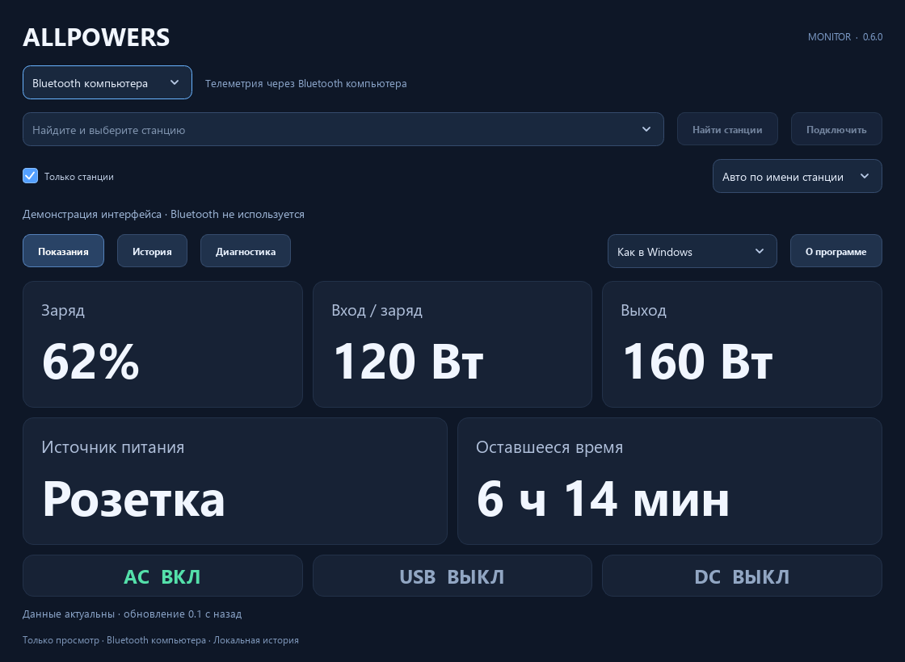
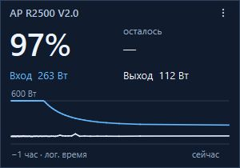

  <a href="README.md">English</a> &nbsp; · &nbsp; <strong>Русский</strong> &nbsp; · &nbsp; <a href="README.zh-CN.md">简体中文</a> &nbsp; · &nbsp; <a href="README.zh-TW.md">繁體中文</a>

<h1 align="center">ALLPOWERS</h1>

   
  <a href="docs/building.md#test-coverage">Ядро, логика прошивки в тестах на ПК и Windows/Qt; выполнение на оборудовании не измеряется.</a> 
  <a href="docs/building.md#mutation-testing">Мутационные тесты запускаются на каждый push/PR: разобранные мутанты приняты, новые выжившие вызывают ошибку CI. Отчёты доступны в GitHub Actions.</a> 
  <a href="docs/building.md#memory-checking-with-valgrind">Valgrind проверяет переносимые тесты на ошибки памяти и утечки при каждом push/PR.</a> 
  <a href="docs/building.md#parser-fuzzing">Парсеры BLE и CDC проходят фаззинг под ASan/UBSan при каждом push/PR.</a>

Телеметрия зарядной станции на рабочем столе. USB-ИБП через поддерживаемую плату.

  <strong><a href="https://github.com/borro/allpowers-bridge/releases">Скачать</a> &nbsp; · &nbsp; <a href="docs/getting-started.md">Первый запуск (EN)</a> &nbsp; · &nbsp; <a href="docs/README.md">Документация (EN)</a></strong>

Windows Monitor и Widget · Waveshare и Pocket · Общее ядро C++23

  

  
  &nbsp;&nbsp;
  
  &nbsp;&nbsp;
  

## Выберите свой вариант

Силовой кабель может поддерживать работу компьютера, но не сообщает, сколько
энергии осталось. ALLPOWERS читает станцию по Bluetooth Low Energy и передаёт
её показания в приложение на компьютере или через плату USB-ИБП.

| Вариант | Возможности |
| --- | --- |
| **Windows Monitor / Widget** | Заряд, входная и выходная мощность, оставшееся время, графики и экспорт CSV. Подключение напрямую по Bluetooth компьютера или через готовую USB-плату. |
| **Плата USB-ИБП** | BLE Central/GATT → стандартный USB HID UPS, дисплей и история. Плата работает независимо от приложения; Windows-приложения могут читать подробную телеметрию через её USB. |

Резервное питание и время переключения зависят от станции. Действия при разряде
задаются настройками ОС; успешная передача телеметрии или HID-данных сама по себе
не подтверждает работу автоматического завершения работы компьютера.

## Первый запуск

1. Скачайте **AllpowersMonitor.exe** или **AllpowersWidget.exe** из
   [Releases](https://github.com/borro/allpowers-bridge/releases). Каждое приложение
   работает самостоятельно в Windows 10/11 x64; устанавливать Qt/Python не нужно.
2. Выберите **Bluetooth** для прямого подключения компьютера или **USB · Waveshare / Pocket**
   для платы, уже подключённой к станции. Найдите и выберите устройство.
3. Убедитесь, что показания свежие. Отсутствующие или устаревшие данные не означают разряженную батарею.

Некоторые станции допускают только одного BLE-клиента. Перед прямым подключением
компьютера отключите другое приложение или плату; чтобы сохранить соединение
платы, используйте USB. Monitor и Widget владеют прямым подключением по очереди.
Для просмотра показаний служба и драйвер ИБП не нужны.

Перед первой прошивкой платы прочитайте [обновление и восстановление](docs/recovery.md).
Плата запоминает станцию; BOOT переключает страницы, двойное нажатие открывает
выбор станции. Для просмотра любого Windows-приложения без оборудования используйте `--demo`.

## Совместимость

| Устройство / вариант | Что подтверждено |
| --- | --- |
| **R2500 V2 + Waveshare ESP32-S3-LCD-1.47** | BLE/GATT и USB HID UPS в Windows проверены 25.10.2026; [запись проверки и её ограничения](docs/validation.md). |
| **Pocket-Dongle-S3 0.96 N16R8** | Сборка и протокольные тесты; работа на оборудовании в этом сценарии не подтверждена. |
| **Другие модели каталога** | Распознаются 17 названий в трёх семействах протокола; это не доказывает совместимость. Передаются только известные поля. |
| **Windows-ИБП через службу и драйвер, без платы** | Экспериментальный вариант для всех моделей. BLE службы, поведение драйвера и действия Windows при разряде не проверены. |

[Возможности моделей](docs/BLUETOOTH.md#compatibility-and-evidence) ·
[Аппаратные проверки](docs/validation.md) · [Экспериментальный Windows-ИБП](docs/windows-ups.md)

## Документация и разработка

Подробные руководства ведутся **на английском**. Интерфейсы Monitor и Widget
доступны на русском, английском, упрощённом и традиционном китайском.

- [Первый запуск](docs/getting-started.md) — загрузка, подключение и подготовка платы.
- [Приложения Windows](docs/windows-apps.md) — языки, графики, виджет, хранение данных и диагностика.
- [Устранение неполадок](docs/troubleshooting.md) — подключение, устаревшие показания и пропуски истории.
- [Оглавление документации](docs/README.md) — платы, протокол USB, восстановление и справочник.
- [Сборка из исходников](docs/building.md) · [Архитектура](docs/architecture.md) · [Участие в проекте](CONTRIBUTING.md).

Код продукта написан на C++23: переносимое ядро, общая прошивка и нативные
Qt-приложения Windows. Сборка использует CMake Presets/Ninja, CTest и CPack;
Linux поддерживает ядро и сборку прошивок, приложения для рабочего стола Linux
пока нет. Сборка и тесты не прошивают платы и не подключаются к станциям.

## Лицензия

Исходный код проекта — [MIT](LICENSE), адаптированный драйвер Windows — MS-PL.
Зависимости сохраняют [свои лицензии](THIRD_PARTY_NOTICES.md). При распространении
бинарных файлов учитывайте [перелинковку Qt](docs/relinking.md) и
[комплекты исходников прошивок](docs/firmware-licenses.md).
