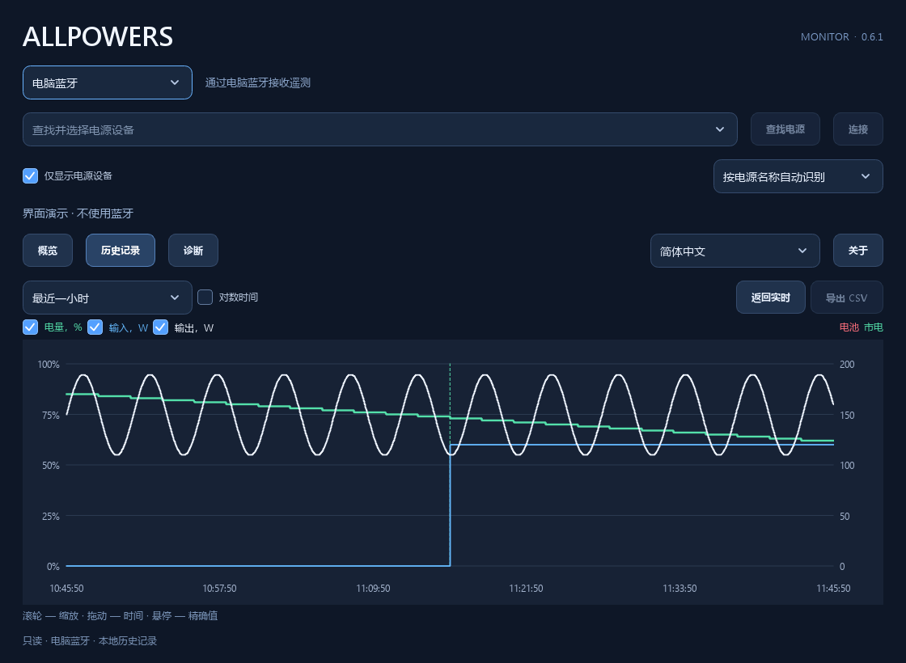

# ALLPOWERS

ALLPOWERS BLE 遥测：一个可移植的 C++23 核心、两款 USB UPS 板卡和原生 Windows 监视器。
[English](README.md) · [Русский](README.ru.md) · [繁體中文](README.zh-TW.md)

## 解决什么问题

户外电源可以为电脑提供备用电力，但供电线不会向电脑报告电池电量、切换至电池供电的状态或剩余运行时间。
这些读数有助于评估备用电量，并配置在电源耗尽前关机。ALLPOWERS 将电源设备的 BLE 遥测数据传递给电脑。

主要有两种使用方式：

- **通过板卡提供 USB UPS。** Waveshare 或 Pocket 通过 BLE 连接电源设备，并以标准 USB HID UPS 的形式报告电池状态。
  无需一直打开监视器；操作系统按照电源设置处理电池策略和操作。Windows 应用也可通过该板卡的 USB 接口读取详细遥测及历史记录。
- **Windows 监视器或桌面小组件。** 应用通过电脑蓝牙直接连接电源设备，或通过 USB 板卡读取数据，显示电量、功率、剩余时间和图表。
  独立查看无需安装服务或驱动程序。不使用板卡、通过 Windows 服务和驱动程序提供 UPS 的方式仍处于实验阶段。

本项目提供电源状态数据。备用供电能力和切换时间取决于电源设备本身。
已经确认的 HID UPS 实现适用于 R2500 V2；其他型号的支持范围见下文。

| 产品 | 连接方式 | 功能 |
| --- | --- | --- |
| Waveshare ESP32-S3-LCD-1.47 | BLE Central → USB Device | HID UPS、屏幕、历史记录、诊断、RGB |
| Pocket-Dongle-S3 0.96 N16R8 | BLE Central → USB Device | HID UPS、紧凑屏幕、历史记录、诊断 |
| Windows Monitor | 电脑蓝牙 / Qt WinRT 或 USB CDC 板卡 | 遥测、图表、诊断；可选的实验性 Windows UPS 集成 |
| Windows Widget | 电脑蓝牙或 USB CDC 板卡 | 独立桌面卡片，显示遥测和一小时功率图表 |

核心可识别 17 个型号名称和三个协议系列。USB UPS 状态报告已针对 R2500 V2 实现；其他配置仅提供已知字段。
部分电源设备只允许一个 BLE 客户端：电脑直接连接前，请先断开板卡。
也可选择 **USB · Waveshare / Pocket**，读取板卡已经建立的连接。
应用分别保存传输方式、USB 序列号和蓝牙电源设备。断开 USB 只关闭电脑端口。
实时读数共用图表、本地历史记录及 CSV 导出；板卡诊断显示在参数表中。无需刷写固件或安装额外驱动程序。
板卡存档会自动填补 USB 主历史图表的空缺；由于记录不含电源设备标识，其来源仍单独标注。
详见 [USB 模式](docs/usb-monitor.md)。

存档诊断区分已验证的完整导入、部分导入和错误。旧版读取器会收到兼容的 AHP1 投影；
要准确保留未知字段的含义，需要当前的版本化导出。固件回退需要元数据匹配、兼容 AHP1/AHP2 的软件包，
详见[恢复说明](docs/recovery.md)。长时间读取存档期间，仍会传送实时 USB 状态。
导入出错后重试，可安全替换板卡上仍在进行的导出。
更新后的桌面应用和固件为每次读取使用新的操作标识，应用重启后也不例外；
[USB 兼容性限制](docs/usb-monitor.md#operation-identity-across-client-restarts)说明了旧固件较弱的操作关联能力。

## 开始使用

运行 **AllpowersMonitor.exe** 打开完整界面，或运行 **AllpowersWidget.exe** 显示桌面卡片。
选择 USB 可使用已连接电源设备的板卡；选择蓝牙可让电脑直接连接。
请先断开另一个直接连接的客户端。若蓝牙正被占用，请在另一应用或板卡上释放连接；本应用不会接管连接。
已安装的 UPS 服务会持有蓝牙连接，并向查看应用提供读数。

“数据已过期”表示所需遥测已超时。缺少读数或读数过期不代表电池已耗尽。
各应用的设置和历史记录分别保存在 `%LOCALAPPDATA%` 下，具体路径及存档限制见下文。

| 协议系列 | 已知遥测 | 硬件验证情况 |
| --- | --- | --- |
| R2500 V2 | 电量、输入/输出、剩余时间、AC/DC/USB 输出状态、明确的市电/电池来源 | 2026-10-25：R2500 V2 + Waveshare 的 BLE/GATT 和 Windows HID UPS；已测试版本见[验证记录](docs/validation.md) |
| Legacy16 | 电量、功率、剩余时间、AC/DC/照明输出状态；USB 输出及市电来源未知 | 离线协议测试；目录中的具体型号和 Pocket 硬件未经验证 |
| Old10 | 电量、功率、剩余时间、循环次数、AC/DC/USB/照明输出状态；市电来源未知 | 离线协议测试；目录中的具体型号未经验证 |

Pocket 已通过编译和协议测试。原生 Windows UPS 驱动程序及服务对所有型号仍属于实验功能；
板卡成功报告 HID 状态并不能验证该驱动程序。仅识别到目录中的型号名称也不能证明兼容。

**界面示例**

<table>
  <tr><th width="33%">Windows 小组件</th><th width="34%">Waveshare · 1.47″</th><th width="33%">Pocket · 0.96″</th></tr>
  <tr>
    <td align="center" valign="middle"><a href="docs/images/windows-widget-zh-CN.png"></a></td>
    <td align="center" valign="middle"><a href="docs/images/waveshare-display.png"></a></td>
    <td align="center" valign="middle"><a href="docs/images/pocket-display.png"></a></td>
  </tr>
</table>

<table>
  <tr><th width="50%">监视器 · 概览</th><th width="50%">监视器 · 历史记录</th></tr>
  <tr>
    <td align="center"><a href="docs/images/windows-monitor-zh-CN.png"></a></td>
    <td align="center"><a href="docs/images/windows-history-zh-CN.png"></a></td>
  </tr>
</table>

两个 Windows 应用均支持俄语、英语、简体中文和繁体中文。
在监视器“关于”旁的选择框，或小组件的“设置”中选择语言。各应用独立保存选择，关闭并重新打开后生效。
默认跟随 Windows：俄语系统使用俄语，中国大陆和新加坡使用简体中文，台湾、香港和澳门使用繁体中文，其余使用英语。
翻译内嵌于每个 EXE。使用 `--demo --language zh-CN` 或 `--demo --language zh-TW` 可单独预览，命令行选择不会保存。

Windows 软件包包含 **AllpowersMonitor.exe** 和 **AllpowersWidget.exe**。
每个应用只需要自己的 EXE：Qt、SQLite、平台插件、协议核心和 C++ 运行时均为静态链接，无需安装 Qt 或 Python。
图表支持滚轮缩放、拖动平移、悬停显示精确值、独立隐藏曲线、线性/对数时间轴、供电切换标记及 CSV 导出。
磁盘操作在界面线程之外执行。监视器的历史记录和设置保存在 `%LOCALAPPDATA%/AllpowersMonitor`。

小组件无需监视器即可运行，其设置和历史记录单独保存在 `%LOCALAPPDATA%/AllpowersWidget`。
首次启动时选择蓝牙或 USB，查找设备并保存。300 × 210 的矩形卡片以设备名称为标题，显示电量、输入/输出、
以天/小时/分钟表示的剩余时间，以及过去一小时的两条功率曲线；缺少数据时曲线会断开。
除菜单按钮外，可拖动卡片任意位置；右键或托盘图标可打开设置、连接、锁定位置和退出。
登录时自动启动默认关闭，可在设置中启用。
普通窗口可覆盖卡片；Win+D 会将其保留在桌面上。如果无法附加到 Explorer，不会显示悬浮窗口：
托盘会报告原因，并自动重试附加。

监视器和小组件轮流持有直接连接：请先在一个应用中断开，再在另一个应用中连接。
连接占用保护要求两个应用都使用新版本；已运行的旧版监视器需要手动断开。
安装 UPS 服务后，小组件读取服务的蓝牙数据，退出时不会停止服务；USB 端口由小组件直接持有。
USB 连接或重连后，小组件会自动读取板卡存档，与当前采样合并为每个指标一条曲线，并保留实际的数据中断。
对数时间轴在一小时范围内为最近的数据分配更多空间。连续有效采样会连线；孤立采样不显示端点圆点。
`AllpowersWidget.exe --demo` 使用临时存储进行无硬件预览，不会修改用户设置或登录启动项。

诊断页包含自动跟随新记录的实时事件日志。向上滚动会暂停跟随，“最新记录 ↓”可恢复；
界面保留 2000 行，磁盘日志独立轮转。当前状态以分组参数/值表显示，也可复制完整 JSON 排查问题。
实验性驱动程序管理位于“诊断”→ **Windows UPS…**。
正常启动时，监视器会根据保存的蓝牙地址和协议配置自动搜索并连接上次使用的电源设备。
设备不可用时会重试搜索；“断开连接”可取消等待和重试。演示及自动化测试不使用真实蓝牙连接。
F11 切换全屏，并恢复此前的普通/最大化状态；概览卡片和文字随窗口空间缩放。

可选的 LocalSystem 服务持有 BLE 和共享历史记录，并向 KMDF Battery Class 小类驱动程序传送状态。
多个监视器可共用该连接。EXE 内嵌驱动程序包，但默认包未签名；安装仅限具有可信签名包的测试虚拟机。
**原生驱动程序/服务的真实 BLE 和 Windows 电源操作尚未验证；虚拟机测试尚未完成。**
无需集成也能独立查看。详见 [Windows UPS 实现及测试状态](docs/windows-ups.md)。

## 构建

使用 Git、CMake 4.4+ 和 Ninja（固定版本为 CMake 4.4.4 / Ninja 1.13.2）。
Windows 还需要 MSVC 2026 C++ Build Tools 和 Windows 11 SDK 10.0.26100.0；在 **x64 Developer PowerShell** 中执行命令。
Linux 需要 C++23 编译器。项目构建、测试和打包不使用 Python 或 uv。

```sh
# Windows：核心、原生测试、监视器和小组件
cmake --preset windows
cmake --build --preset windows
ctest --preset windows
cmake --build --preset release

# Linux：可移植核心及测试（暂无 Linux 桌面应用）
cmake --preset native
cmake --build --preset native
ctest --preset native
```

首次 Windows 构建会下载经校验和固定的 Qt 6.12.0 源代码，通过 ExternalProject 构建静态 MSVC/WinRT SDK，后续复用。
可使用 `-DALLPOWERS_QT_ROOT=/path/to/qt` 指定已有的静态 Qt，需包含匹配版本的 LinguistTools。
Release 应用程序和受管理的 Qt SDK 使用体积优化及普通链接，不启用 LTO；Debug 设置保持不变。
GitHub Actions 也会缓存已安装 SDK；严格的兼容性键包含 Qt/构建输入、MSVC、Windows SDK、架构、工具和安装路径。
恢复的 SDK 必须通过编译、链接和离线运行检查；缓存缺失或被拒绝时从源代码构建。
Windows 目标还使用固定校验和的 WDK 10.0.26100.6584（KMDF 1.31）构建并内嵌驱动程序，检查 INF、目录和内核 PE。
`ups-driver` 仅构建该包；构建及测试不会安装驱动程序。

两种预设均提供固件目标：

```sh
cmake --build build/windows --target arduino-setup
cmake --build build/windows --target waveshare-147 pocket-096
```

Linux 使用 `build/native`。环境固定为 Arduino CLI 1.5.1 和 ESP32 Core 3.3.11。
`cmake --build --preset all-windows` 或 `all-linux` 构建所有支持的产品。
各板卡有独立的草图和构建暂存目录，不修改源代码。构建、CTest 和打包均不会刷写设备或连接电源设备。

输出：中间文件位于 `build/`，固件位于 `dist/firmware/<board>/`，Windows EXE 位于 `dist/windows/AllpowersMonitor/`。
`release` 目标使用 CPack 生成运行包和对应源代码 ZIP 及 SHA256 文件。
运行包中的 EXE 副本使用 UPX `-9` 压缩，普通构建及安装输出保持未压缩，以便快速开发。
仅在发布打包时下载 UPX 5.2.1，并验证固定的 SHA256；归档前检查压缩文件的完整性、版本与离线独立运行。
某些杀毒软件可能误报压缩文件；可用 `upx -d` 解压 EXE。
`AllpowersMonitor-<版本>-sources-with-qt.zip` 包含用于重新构建的完整应用和 Qt 源代码以及重新链接说明，应随二进制发行包一并提供。GitHub 自动生成的 Source code 下载仅包含仓库内容。
每个固件包也包含 LGPL 对应源代码、许可证声明和经过测试的重新链接对象文件包，见[固件许可证](docs/firmware-licenses.md)。
Windows 发布者需要有效的 Visual Studio 许可证；符合条件的个人和开源开发可使用 Community，见[运行时条款](docs/windows-runtime-terms.md)。

## GitHub 构建和发布检查

GitHub Actions 响应 `main`、标签、拉取请求和手动运行。功能分支使用 PR 检查，避免重复的推送构建；创建 PR 前可手动启动。
CI 在两个平台安装经过校验和验证的 Ninja 1.13.2。
发布检查覆盖索引、工作树和可达历史，包括固定版本的 Gitleaks 密钥扫描。
Windows Server 2025 构建静态监视器、小组件及驱动程序，Ubuntu 24.04 构建可移植核心；两者均编译两个板卡配置并运行 CTest。
Windows 还会重新构建和测试源代码包，并生成附带校验和的 CPack ZIP。成功构建的产物保留 14 天。
CTest 预设使用四个并行任务运行完整测试；串行运行可用 `--parallel 1`。标签构建使用相同的打包检查。

推送 `v1.2.3` 或 `v1.2.3-alpha.1` 之类的版本标签后，两个平台通过检查才会发布
[GitHub Release](https://github.com/borro/allpowers-bridge/releases)。
其中包含独立的 Monitor/Widget EXE、两款板卡的固件 ZIP、完整应用/Qt 源代码，以及涵盖全部下载文件的一个 `SHA256SUMS` 文件。
应用和 Windows EXE 属性使用去掉 `v` 的标签版本。预发行标签生成 GitHub 预发行版本；普通分支/PR 构建生成产物。
构建不会安装或刷写设备，也不需要个人访问令牌。见[发布保护和重试](docs/building.md#tagged-releases)。

提交前运行 `audit-worktree`，审查并暂存文件后，在已配置的构建目录运行 `audit`、`audit-history` 和 `audit-secrets`。
源代码包使用经过审查的文件清单，而非复制整个目录。私有配置、恢复镜像和本地构建缓存不进入 Git。
相关命令见[构建及发布文档](docs/building.md)。

## 版本和目录结构

产品版本来自 `v0.4.0` 等 Git 标签，通过 `git describe` 生成。
标签 CI 精确选择触发它的标签并校验提交；中间构建包含提交及工作树修改信息。
源代码包携带生成的 `VERSION` 文件，在没有 Git 的解压目录中也保留版本。CMake 或包清单中没有手动维护的产品版本号。

`core/` 包含协议、型号状态和 C ABI v1；`firmware/` 在板卡配置间共享逻辑；`apps/windows/` 是原生 Qt 监视器；
`tests/` 包含 C++ 测试和已去除敏感信息的测试数据；`cmake/` 管理构建、依赖和打包规则。
`drivers/windows/` 包含可选的电池小类驱动程序；`tools/` 仅用于显式执行板卡维护，包括更新、身份匹配和镜像完整性检查。
真实设备身份、端口和回退路径保存在忽略的本地设置中，不作为公开默认值。

板卡将所选电源设备保存在 NVS 中；未选择时打开设备选择器。BOOT 切换页面，双击 BOOT 打开选择器，RESET 仍执行硬件复位。
写入固件前请阅读[恢复说明](docs/recovery.md)。C ABI、USB 描述符、Flash 分区和现有维护命令保持兼容。

[构建详情](docs/building.md) · [架构](docs/architecture.md) · [板卡](docs/boards.md) ·
[验证记录](docs/validation.md) · [重新链接](docs/relinking.md)

项目原创代码使用 MIT 许可证；适配的 Windows 驱动程序使用 MS-PL。
[第三方声明](THIRD_PARTY_NOTICES.md)保留其各自许可证。出厂镜像、原始抓包和用户数据保存在 Git 之外。

翻译维护：`cmake --build build/windows/windows-monitor --target update-translations` 显式更新俄语及两种中文的 Qt Linguist 目录。
普通构建只编译并内嵌翻译，不修改源文件；`translation-coverage` 检查翻译是否完整。
