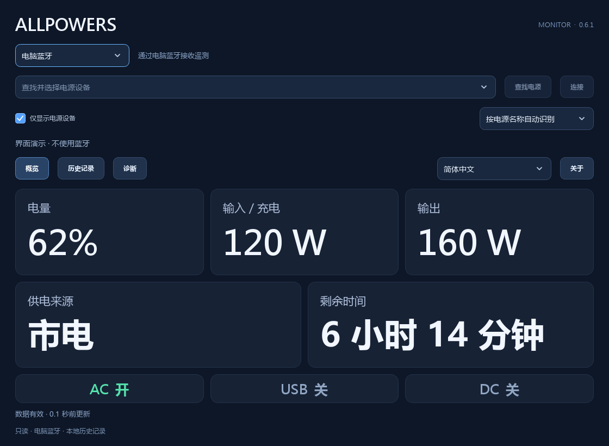

  <a href="README.md">English</a> &nbsp; · &nbsp; <a href="README.ru.md">Русский</a> &nbsp; · &nbsp; <strong>简体中文</strong> &nbsp; · &nbsp; <a href="README.zh-TW.md">繁體中文</a>

<h1 align="center">ALLPOWERS</h1>

   
  <a href="docs/building.md#test-coverage">包括核心、在主机上测试的固件逻辑和 Windows/Qt；不衡量硬件上的执行情况。</a>

在桌面查看电源设备遥测。通过受支持的板卡提供 USB UPS 状态报告。

  <strong><a href="https://github.com/borro/allpowers-bridge/releases">下载</a> &nbsp; · &nbsp; <a href="docs/getting-started.md">快速开始（英语）</a> &nbsp; · &nbsp; <a href="docs/README.md">文档（英语）</a></strong>

Windows 监视器与小组件 · Waveshare 与 Pocket · 共用 C++23 核心

  

  
  &nbsp;&nbsp;
  
  &nbsp;&nbsp;
  

## 选择使用方式

供电线可以维持电脑运行，却不会告诉电脑还剩多少电量。ALLPOWERS 通过低功耗蓝牙读取电源设备，
并将读数呈现在桌面应用中，或通过 USB UPS 板卡传递给电脑。

| 方式 | 功能 |
| --- | --- |
| **Windows 监视器 / 小组件** | 电量、输入/输出功率、剩余时间、图表及 CSV 导出。通过电脑蓝牙直接连接，或通过 USB 读取已配置的板卡。 |
| **USB UPS 板卡** | BLE Central/GATT → 标准 USB HID UPS，带屏幕和历史记录。板卡可独立于桌面应用运行；Windows 应用可通过其 USB 读取详细遥测。 |

备用供电能力和切换时间取决于电源设备。电池操作由操作系统的电源设置决定；
成功接收遥测或 HID 数据本身并不能证明自动关机已正常工作。

## 快速开始

1. 从 [Releases](https://github.com/borro/allpowers-bridge/releases) 下载 **AllpowersMonitor.exe**
   或 **AllpowersWidget.exe**。两者均可独立运行于 Windows 10/11 x64，无需安装 Qt/Python。
2. 选择 **Bluetooth** 让电脑直接连接，或选择 **USB · Waveshare / Pocket** 读取已连接电源设备的板卡。搜索并选择设备。
3. 确认读数是最新的。缺少读数或数据过期不表示电池已耗尽。

部分电源设备只允许一个 BLE 客户端。电脑直接连接前，请断开另一应用或板卡；
如需保留板卡连接，请使用 USB。监视器与小组件轮流持有直接连接。
仅查看遥测无需服务或 UPS 驱动程序。

首次烧录板卡前，请阅读[更新与恢复](docs/recovery.md)。板卡会记住所选电源设备；
BOOT 切换页面，双击 BOOT 打开设备选择器。两个 Windows 应用均支持 `--demo`，可在无硬件时预览。

## 兼容性

| 设备 / 方式 | 当前验证情况 |
| --- | --- |
| **R2500 V2 + Waveshare ESP32-S3-LCD-1.47** | 2026-10-25 已验证 BLE/GATT 及 Windows USB HID UPS；详见[验证记录与限制](docs/validation.md)。 |
| **Pocket-Dongle-S3 0.96 N16R8** | 已通过编译和协议测试；尚未验证此场景下的硬件运行情况。 |
| **目录中的其他型号** | 可识别三个协议系列中的 17 个名称；名称识别不等于兼容。仅提供已知字段。 |
| **无需板卡的 Windows UPS 服务/驱动程序** | 对所有型号均属实验功能。原生服务 BLE、驱动程序行为及 Windows 电源操作尚未验证。 |

[型号功能](docs/BLUETOOTH.md#compatibility-and-evidence) ·
[硬件验证](docs/validation.md) · [实验性 Windows UPS](docs/windows-ups.md)

## 文档与开发

详细文档使用**英语**。监视器和小组件界面支持俄语、英语、简体中文和繁体中文。

- [快速开始](docs/getting-started.md) — 下载、首次连接和板卡准备。
- [Windows 应用](docs/windows-apps.md) — 语言、图表、小组件、数据存储和诊断。
- [故障排除](docs/troubleshooting.md) — 连接问题、过期读数及历史记录缺口。
- [文档目录](docs/README.md) — 硬件、USB 协议、恢复与参考资料。
- [从源码构建](docs/building.md) · [架构](docs/architecture.md) · [参与贡献](CONTRIBUTING.md)。

产品代码使用 C++23：可移植核心、共用固件和原生 Qt Windows 应用。
构建采用 CMake Presets/Ninja、CTest 和 CPack；Linux 支持核心和固件构建，尚无 Linux 桌面应用。
构建及测试命令不会烧录板卡或连接电源设备。

## 许可证

项目原创代码采用 [MIT](LICENSE)，改编的 Windows 驱动程序采用 MS-PL。
依赖项保留[各自的许可证](THIRD_PARTY_NOTICES.md)。重新分发二进制文件时，请参阅
[Qt 重新链接](docs/relinking.md)及[固件源码包](docs/firmware-licenses.md)。
