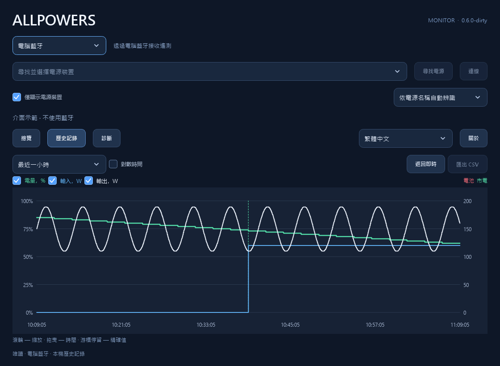

# ALLPOWERS

ALLPOWERS BLE 遙測：一個可攜式 C++23 核心、兩款 USB UPS 板卡與原生 Windows 監視器。
[English](README.md) · [Русский](README.ru.md) · [简体中文](README.zh-CN.md)

## 解決什麼問題

行動電源站可以為電腦提供備援電力，但供電線不會向電腦回報電池電量、切換至電池供電的狀態或剩餘執行時間。
這些讀數有助於評估備援電量，並設定在電源耗盡前關機。ALLPOWERS 將電源裝置的 BLE 遙測資料傳遞給電腦。

主要有兩種使用方式：

- **透過板卡提供 USB UPS。** Waveshare 或 Pocket 透過 BLE 連線至電源裝置，並以標準 USB HID UPS 的形式回報電池狀態。
  無須持續開啟監視器；作業系統依照電源設定處理電池原則與操作。Windows 應用程式也可透過該板卡的 USB 介面讀取詳細遙測及歷史記錄。
- **Windows 監視器或桌面小工具。** 應用程式透過電腦藍牙直接連線至電源裝置，或透過 USB 板卡讀取資料，顯示電量、功率、剩餘時間與圖表。
  獨立檢視無須安裝服務或驅動程式。不使用板卡、透過 Windows 服務與驅動程式提供 UPS 的方式仍處於實驗階段。

本專案提供電源狀態資料。備援供電能力與切換時間取決於電源裝置本身。
已確認的 HID UPS 實作適用於 R2500 V2；其他型號的支援範圍見下文。

| 產品 | 連線方式 | 功能 |
| --- | --- | --- |
| Waveshare ESP32-S3-LCD-1.47 | BLE Central → USB Device | HID UPS、螢幕、歷史記錄、診斷、RGB |
| Pocket-Dongle-S3 0.96 N16R8 | BLE Central → USB Device | HID UPS、精巧螢幕、歷史記錄、診斷 |
| Windows Monitor | 電腦藍牙 / Qt WinRT 或 USB CDC 板卡 | 遙測、圖表、診斷；選用的實驗性 Windows UPS 整合 |
| Windows Widget | 電腦藍牙或 USB CDC 板卡 | 獨立桌面卡片，顯示遙測與一小時功率圖表 |

核心可辨識 17 個型號名稱與三個協定系列。USB UPS 狀態回報已針對 R2500 V2 實作；其他設定僅提供已知欄位。
部分電源裝置只允許一個 BLE 用戶端：電腦直接連線前，請先中斷板卡連線。
也可選擇 **USB · Waveshare / Pocket**，讀取板卡已建立的連線。
應用程式分別儲存傳輸方式、USB 序號與藍牙電源裝置。中斷 USB 只關閉電腦端連接埠。
即時讀數共用圖表、本機歷史記錄及 CSV 匯出；板卡診斷顯示於參數表中。無須燒錄韌體或安裝額外驅動程式。
板卡封存資料會自動填補 USB 主歷史圖表的空缺；由於記錄不含電源裝置識別資訊，其來源仍會單獨標示。
詳見 [USB 模式](docs/usb-monitor.md)。

封存資料診斷區分已驗證的完整匯入、部分匯入與錯誤。舊版讀取器會收到相容的 AHP1 投影；
若要準確保留未知欄位的含義，需要目前的版本化匯出。韌體回復需要中繼資料相符、相容於 AHP1/AHP2 的套件，
詳見[復原說明](docs/recovery.md)。長時間讀取封存資料期間，仍會傳送即時 USB 狀態。
匯入出錯後重試，可安全取代板卡上仍在進行的匯出。
更新後的桌面應用程式與韌體為每次讀取使用新的操作識別碼，應用程式重新啟動後也不例外；
[USB 相容性限制](docs/usb-monitor.md#operation-identity-across-client-restarts)說明了舊韌體較弱的操作關聯能力。

## 開始使用

執行 **AllpowersMonitor.exe** 開啟完整介面，或執行 **AllpowersWidget.exe** 顯示桌面卡片。
選擇 USB 可使用已連線至電源裝置的板卡；選擇藍牙可讓電腦直接連線。
請先中斷另一個直接連線的用戶端。若藍牙正在使用中，請在另一應用程式或板卡上釋放連線；本應用程式不會接管連線。
已安裝的 UPS 服務會持有藍牙連線，並向檢視應用程式提供讀數。

「資料已過期」表示所需遙測已逾時。缺少讀數或讀數過期不代表電池已耗盡。
各應用程式的設定與歷史記錄分別儲存在 `%LOCALAPPDATA%` 下，具體路徑及封存資料限制見下文。

| 協定系列 | 已知遙測 | 硬體驗證情況 |
| --- | --- | --- |
| R2500 V2 | 電量、輸入/輸出、剩餘時間、AC/DC/USB 輸出狀態、明確的市電/電池來源 | 2026-10-25：R2500 V2 + Waveshare 的 BLE/GATT 與 Windows HID UPS；已測試版本見[驗證記錄](docs/validation.md) |
| Legacy16 | 電量、功率、剩餘時間、AC/DC/照明輸出狀態；USB 輸出及市電來源未知 | 離線協定測試；目錄中的個別型號與 Pocket 硬體未經驗證 |
| Old10 | 電量、功率、剩餘時間、循環次數、AC/DC/USB/照明輸出狀態；市電來源未知 | 離線協定測試；目錄中的個別型號未經驗證 |

Pocket 已通過編譯與協定測試。原生 Windows UPS 驅動程式及服務對所有型號仍屬實驗功能；
板卡成功回報 HID 狀態並不能驗證該驅動程式。僅辨識到目錄中的型號名稱也不能證明相容。

**介面範例**

<table>
  <tr><th width="33%">Windows 小工具</th><th width="34%">Waveshare · 1.47″</th><th width="33%">Pocket · 0.96″</th></tr>
  <tr>
    <td align="center" valign="middle"><a href="docs/images/windows-widget-zh-TW.png"></a></td>
    <td align="center" valign="middle"><a href="docs/images/waveshare-display.png"></a></td>
    <td align="center" valign="middle"><a href="docs/images/pocket-display.png"></a></td>
  </tr>
</table>

<table>
  <tr><th width="50%">監視器 · 總覽</th><th width="50%">監視器 · 歷史記錄</th></tr>
  <tr>
    <td align="center"><a href="docs/images/windows-monitor-zh-TW.png"></a></td>
    <td align="center"><a href="docs/images/windows-history-zh-TW.png"></a></td>
  </tr>
</table>

兩個 Windows 應用程式均支援俄文、英文、簡體中文與繁體中文。
在監視器「關於」旁的選擇方塊，或小工具的「設定」中選擇語言。各應用程式獨立儲存選擇，關閉並重新開啟後生效。
預設跟隨 Windows：俄文系統使用俄文，中國大陸與新加坡使用簡體中文，臺灣、香港與澳門使用繁體中文，其餘使用英文。
翻譯內嵌於每個 EXE。使用 `--demo --language zh-CN` 或 `--demo --language zh-TW` 可單獨預覽，命令列選擇不會儲存。

Windows 套件包含 **AllpowersMonitor.exe** 與 **AllpowersWidget.exe**。
每個應用程式只需要自己的 EXE：Qt、SQLite、平台外掛程式、協定核心與 C++ 執行階段均為靜態連結，無須安裝 Qt 或 Python。
圖表支援滾輪縮放、拖曳平移、游標停留顯示精確值、獨立隱藏曲線、線性/對數時間軸、供電切換標記及 CSV 匯出。
磁碟操作在介面執行緒之外執行。監視器的歷史記錄與設定儲存在 `%LOCALAPPDATA%/AllpowersMonitor`。

小工具無須監視器即可執行，其設定與歷史記錄單獨儲存在 `%LOCALAPPDATA%/AllpowersWidget`。
首次啟動時選擇藍牙或 USB，尋找裝置並儲存。300 × 210 的矩形卡片以裝置名稱為標題，顯示電量、輸入/輸出、
以天/小時/分鐘表示的剩餘時間，以及過去一小時的兩條功率曲線；缺少資料時曲線會中斷。
除選單按鈕外，可拖曳卡片任意位置；按滑鼠右鍵或系統匣圖示可開啟設定、連線、鎖定位置與結束。
登入時自動啟動預設關閉，可在設定中啟用。
一般視窗可覆蓋卡片；Win+D 會將其保留在桌面上。如果無法附加至 Explorer，不會顯示浮動視窗：
系統匣會回報原因，並自動重試附加。

監視器與小工具輪流持有直接連線：請先在一個應用程式中中斷連線，再在另一個應用程式中連線。
連線使用權保護要求兩個應用程式皆使用新版本；已執行的舊版監視器需要手動中斷連線。
安裝 UPS 服務後，小工具讀取服務的藍牙資料，結束時不會停止服務；USB 連接埠由小工具直接持有。
USB 連線或重新連線後，小工具會自動讀取板卡封存資料，與目前取樣合併為每個指標一條曲線，並保留實際的資料中斷。
對數時間軸在一小時範圍內為最近的資料分配更多空間。連續有效取樣會連線；孤立取樣不顯示端點圓點。
`AllpowersWidget.exe --demo` 使用暫存儲存空間進行無硬體預覽，不會修改使用者設定或登入啟動項目。

診斷頁包含自動跟隨新記錄的即時事件記錄。向上捲動會暫停跟隨，「最新記錄 ↓」可恢復；
介面保留 2000 行，磁碟記錄獨立輪替。目前狀態以分組參數/值表顯示，也可複製完整 JSON 排解問題。
實驗性驅動程式管理位於「診斷」→ **Windows UPS…**。
正常啟動時，監視器會依據儲存的藍牙位址與協定設定自動搜尋並連線至上次使用的電源裝置。
裝置無法使用時會重試搜尋；「中斷連線」可取消等候與重試。示範及自動化測試不使用真實藍牙連線。
F11 切換全螢幕，並恢復先前的一般/最大化狀態；總覽卡片與文字隨視窗空間縮放。

選用的 LocalSystem 服務持有 BLE 與共用歷史記錄，並向 KMDF Battery Class 迷你類別驅動程式傳送狀態。
多個監視器可共用該連線。EXE 內嵌驅動程式套件，但預設套件未簽署；安裝僅限具有可信簽署套件的測試虛擬機器。
**原生驅動程式/服務的真實 BLE 與 Windows 電源操作尚未驗證；虛擬機器測試尚未完成。**
無須整合也能獨立檢視。詳見 [Windows UPS 實作及測試狀態](docs/windows-ups.md)。

## 建置

使用 Git、CMake 4.4+ 與 Ninja（固定版本為 CMake 4.4.4 / Ninja 1.13.2）。
Windows 還需要 MSVC 2026 C++ Build Tools 與 Windows 11 SDK 10.0.26100.0；在 **x64 Developer PowerShell** 中執行命令。
Linux 需要 C++23 編譯器。專案建置、測試與封裝不使用 Python 或 uv。

```sh
# Windows：核心、原生測試、監視器與小工具
cmake --preset windows
cmake --build --preset windows
ctest --preset windows
cmake --build --preset release

# Linux：可攜式核心及測試（尚無 Linux 桌面應用程式）
cmake --preset native
cmake --build --preset native
ctest --preset native
```

首次 Windows 建置會下載以檢查碼固定的 Qt 6.12.0 原始碼，透過 ExternalProject 建置靜態 MSVC/WinRT SDK，後續重複使用。
可使用 `-DALLPOWERS_QT_ROOT=/path/to/qt` 指定現有的靜態 Qt，需包含相符版本的 LinguistTools。
Release 應用程式與受管理的 Qt SDK 使用體積最佳化及一般連結，不啟用 LTO；Debug 設定維持不變。
GitHub Actions 也會快取已安裝的 SDK；嚴格的相容性索引鍵包含 Qt/建置輸入、MSVC、Windows SDK、架構、工具與安裝路徑。
還原的 SDK 必須通過編譯、連結與離線執行檢查；快取缺少或遭拒絕時，會從原始碼建置。
Windows 目標還使用固定檢查碼的 WDK 10.0.26100.6584（KMDF 1.31）建置並內嵌驅動程式，檢查 INF、目錄與核心 PE。
`ups-driver` 僅建置該套件；建置及測試不會安裝驅動程式。

兩種預設皆提供韌體目標：

```sh
cmake --build build/windows --target arduino-setup
cmake --build build/windows --target waveshare-147 pocket-096
```

Linux 使用 `build/native`。環境固定為 Arduino CLI 1.5.1 與 ESP32 Core 3.3.11。
`cmake --build --preset all-windows` 或 `all-linux` 建置所有支援的產品。
各板卡有獨立的草圖與建置暫存目錄，不修改原始碼。建置、CTest 與封裝皆不會燒錄裝置或連線至電源裝置。

輸出：中間檔案位於 `build/`，韌體位於 `dist/firmware/<board>/`，Windows EXE 位於 `dist/windows/AllpowersMonitor/`。
`release` 目標使用 CPack 產生執行套件與對應原始碼 ZIP 及 SHA256 檔案。
執行套件中的 EXE 副本使用 UPX `-9` 壓縮，一般建置及安裝輸出保持未壓縮，以便快速開發。
僅在發布封裝時下載 UPX 5.2.1，並驗證固定的 SHA256；歸檔前檢查壓縮檔案的完整性、版本與離線獨立執行。
部分防毒軟體可能誤報壓縮檔案；可用 `upx -d` 解壓縮 EXE。
`AllpowersMonitor-<版本>-sources-with-qt.zip` 包含用於重新建置的完整應用程式與 Qt 原始碼以及重新連結說明，應隨二進位發行套件一併提供。GitHub 自動產生的 Source code 下載僅包含儲存庫內容。
每個韌體套件也包含 LGPL 對應原始碼、授權聲明及經過測試的重新連結目的檔套件，見[韌體授權條款](docs/firmware-licenses.md)。
Windows 發布者需要有效的 Visual Studio 授權；符合條件的個人與開源開發可使用 Community，見[執行階段條款](docs/windows-runtime-terms.md)。

## GitHub 建置與發布檢查

GitHub Actions 回應 `main`、標籤、提取要求與手動執行。功能分支使用 PR 檢查，以避免重複的推送建置；建立 PR 前可手動啟動。
CI 在兩個平台安裝經檢查碼驗證的 Ninja 1.13.2。
發布檢查涵蓋索引、工作目錄與可達歷程記錄，包括固定版本的 Gitleaks 機密掃描。
Windows Server 2025 建置靜態監視器、小工具及驅動程式，Ubuntu 24.04 建置可攜式核心；兩者皆編譯兩個板卡設定並執行 CTest。
Windows 還會重新建置與測試原始碼套件，並產生附帶檢查碼的 CPack ZIP。成功建置的產物保留 14 天。
CTest 預設使用四個平行工作執行完整測試；循序執行可用 `--parallel 1`。標籤建置使用相同的封裝檢查。

推送 `v1.2.3` 或 `v1.2.3-alpha.1` 之類的版本標籤後，兩個平台通過檢查才會發布
[GitHub Release](https://github.com/borro/allpowers-bridge/releases)。
其中包含獨立的 Monitor/Widget EXE、兩款板卡的韌體 ZIP、完整應用程式/Qt 原始碼，以及涵蓋全部下載檔案的一個 `SHA256SUMS` 檔案。
應用程式與 Windows EXE 屬性使用移除 `v` 的標籤版本。預先發行標籤產生 GitHub 預先發行版本；一般分支/PR 建置產生產物。
建置不會安裝或燒錄裝置，也不需要個人存取權杖。見[發布保護與重試](docs/building.md#tagged-releases)。

提交前執行 `audit-worktree`，檢閱並暫存檔案後，在已設定的建置目錄執行 `audit`、`audit-history` 與 `audit-secrets`。
原始碼套件使用經過檢閱的檔案清單，而非複製整個目錄。私有設定、復原映像與本機建置快取不進入 Git。
相關命令見[建置及發布文件](docs/building.md)。

## 版本與目錄結構

產品版本來自 `v0.4.0` 等 Git 標籤，透過 `git describe` 產生。
標籤 CI 精確選擇觸發它的標籤並驗證提交；中間建置包含提交及工作目錄變更資訊。
原始碼套件攜帶產生的 `VERSION` 檔案，在沒有 Git 的解壓縮目錄中也保留版本。CMake 或套件資訊清單中沒有手動維護的產品版本號。

`core/` 包含協定、型號狀態與 C ABI v1；`firmware/` 在板卡設定間共用邏輯；`apps/windows/` 是原生 Qt 監視器；
`tests/` 包含 C++ 測試與已移除敏感資訊的測試資料；`cmake/` 管理建置、相依性與封裝規則。
`drivers/windows/` 包含選用的電池迷你類別驅動程式；`tools/` 僅用於明確執行板卡維護，包括更新、身分比對與映像完整性檢查。
真實裝置身分、連接埠與回復路徑儲存在忽略的本機設定中，不作為公開預設值。

板卡將所選電源裝置儲存在 NVS 中；尚未選擇時開啟裝置選擇器。BOOT 切換頁面，按兩下 BOOT 開啟選擇器，RESET 仍執行硬體重設。
寫入韌體前請閱讀[復原說明](docs/recovery.md)。C ABI、USB 描述元、Flash 分割區與既有維護命令保持相容。

[建置詳情](docs/building.md) · [架構](docs/architecture.md) · [板卡](docs/boards.md) ·
[驗證記錄](docs/validation.md) · [重新連結](docs/relinking.md)

專案原創程式碼使用 MIT 授權；適配的 Windows 驅動程式使用 MS-PL。
[第三方聲明](THIRD_PARTY_NOTICES.md)保留其各自授權。出廠映像、原始封包擷取與使用者資料儲存在 Git 之外。

翻譯維護：`cmake --build build/windows/windows-monitor --target update-translations` 明確更新俄文及兩種中文的 Qt Linguist 目錄。
一般建置只編譯並內嵌翻譯，不修改原始檔案；`translation-coverage` 檢查翻譯是否完整。
