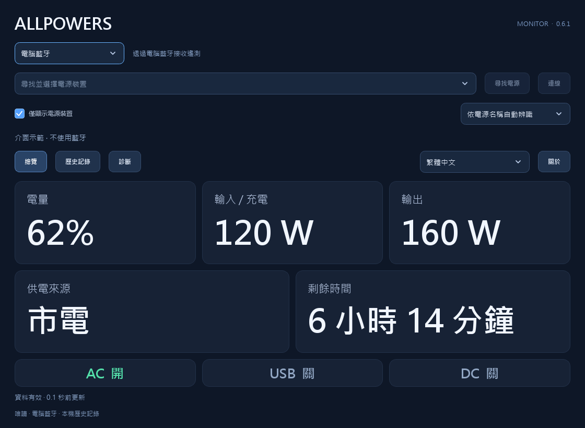
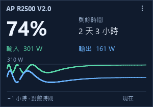

  <a href="README.md">English</a> &nbsp; · &nbsp; <a href="README.ru.md">Русский</a> &nbsp; · &nbsp; <a href="README.zh-CN.md">简体中文</a> &nbsp; · &nbsp; <strong>繁體中文</strong>

<h1 align="center">ALLPOWERS</h1>

  
  
  
  

在桌面檢視電源裝置遙測。透過支援的板卡提供 USB UPS 狀態回報。

  <strong><a href="https://github.com/borro/allpowers-bridge/releases">下載</a> &nbsp; · &nbsp; <a href="docs/getting-started.md">快速開始（英語）</a> &nbsp; · &nbsp; <a href="docs/README.md">文件（英語）</a></strong>

Windows 監視器與小工具 · Waveshare 與 Pocket · 共用 C++23 核心

  

  
  &nbsp;&nbsp;
  
  &nbsp;&nbsp;
  

## 選擇使用方式

供電線可以維持電腦運作，卻不會告訴電腦還剩多少電量。ALLPOWERS 透過低功耗藍牙讀取電源裝置，
並將讀數呈現在桌面應用程式中，或透過 USB UPS 板卡傳遞給電腦。

| 方式 | 功能 |
| --- | --- |
| **Windows 監視器 / 小工具** | 電量、輸入/輸出功率、剩餘時間、圖表及 CSV 匯出。透過電腦藍牙直接連線，或透過 USB 讀取已設定的板卡。 |
| **USB UPS 板卡** | BLE Central/GATT → 標準 USB HID UPS，附螢幕和歷史記錄。板卡可獨立於桌面應用程式運作；Windows 應用程式可透過其 USB 讀取詳細遙測。 |

備援供電能力和切換時間取決於電源裝置。電池操作由作業系統的電源設定決定；
成功接收遙測或 HID 資料本身並不能證明自動關機已正常運作。

## 快速開始

1. 從 [Releases](https://github.com/borro/allpowers-bridge/releases) 下載 **AllpowersMonitor.exe**
   或 **AllpowersWidget.exe**。兩者均可獨立執行於 Windows 10/11 x64，無須安裝 Qt/Python。
2. 選擇 **Bluetooth** 讓電腦直接連線，或選擇 **USB · Waveshare / Pocket** 讀取已連線至電源裝置的板卡。搜尋並選擇裝置。
3. 確認讀數是最新的。缺少讀數或資料過期不表示電池已耗盡。

部分電源裝置只允許一個 BLE 用戶端。電腦直接連線前，請中斷另一應用程式或板卡的連線；
如需保留板卡連線，請使用 USB。監視器與小工具輪流持有直接連線。
僅檢視遙測無須服務或 UPS 驅動程式。

首次燒錄板卡前，請閱讀[更新與復原](docs/recovery.md)。板卡會記住所選電源裝置；
BOOT 切換頁面，按兩下 BOOT 開啟裝置選擇器。兩個 Windows 應用程式均支援 `--demo`，可在無硬體時預覽。

## 相容性

| 裝置 / 方式 | 目前驗證情況 |
| --- | --- |
| **R2500 V2 + Waveshare ESP32-S3-LCD-1.47** | 2026-10-25 已驗證 BLE/GATT 及 Windows USB HID UPS；詳見[驗證記錄與限制](docs/validation.md)。 |
| **Pocket-Dongle-S3 0.96 N16R8** | 已通過編譯和協定測試；尚未驗證此情境下的硬體運作情況。 |
| **目錄中的其他型號** | 可辨識三個協定系列中的 17 個名稱；名稱辨識不等於相容。僅提供已知欄位。 |
| **無須板卡的 Windows UPS 服務/驅動程式** | 對所有型號均屬實驗功能。原生服務 BLE、驅動程式行為及 Windows 電源操作尚未驗證。 |

[型號功能](docs/BLUETOOTH.md#compatibility-and-evidence) ·
[硬體驗證](docs/validation.md) · [實驗性 Windows UPS](docs/windows-ups.md)

## 文件與開發

詳細文件使用**英語**。監視器和小工具介面支援俄語、英語、簡體中文和繁體中文。

- [快速開始](docs/getting-started.md) — 下載、首次連線和板卡準備。
- [Windows 應用程式](docs/windows-apps.md) — 語言、圖表、小工具、資料儲存和診斷。
- [疑難排解](docs/troubleshooting.md) — 連線問題、過期讀數及歷史記錄缺口。
- [文件目錄](docs/README.md) — 硬體、USB 協定、復原與參考資料。
- [從原始碼建置](docs/building.md) · [架構](docs/architecture.md) · [參與貢獻](CONTRIBUTING.md)。

產品程式碼使用 C++23：可攜式核心、共用韌體和原生 Qt Windows 應用程式。
建置採用 CMake Presets/Ninja、CTest 和 CPack；Linux 支援核心和韌體建置，尚無 Linux 桌面應用程式。
建置及測試命令不會燒錄板卡或連線至電源裝置。

## 授權

專案原創程式碼採用 [MIT](LICENSE)，改編的 Windows 驅動程式採用 MS-PL。
相依項目保留[各自的授權](THIRD_PARTY_NOTICES.md)。重新散布二進位檔案時，請參閱
[Qt 重新連結](docs/relinking.md)及[韌體原始碼與重新建置](docs/firmware-licenses.md)。
